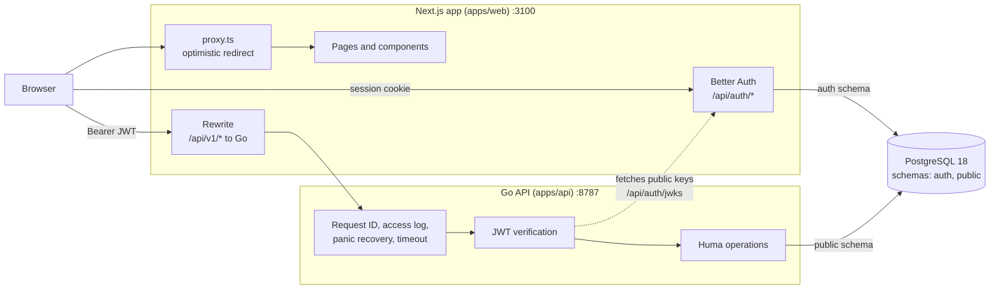
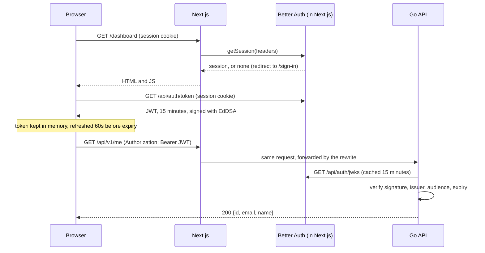
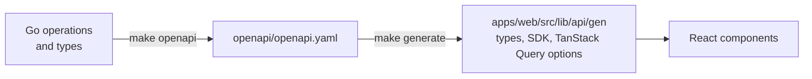

# Architecture

The system has three parts: a Next.js web app, a Go API, and one PostgreSQL database. The browser only ever talks to the web app's origin. The web app handles sign-in and forwards API calls to Go. Go owns the business data and trusts nothing it cannot verify itself.



## Responsibilities

| Part | Owns | Does not do |
| --- | --- | --- |
| **Web app** (`apps/web`) | Pages, sign-up and sign-in, sessions, issuing short-lived API tokens, forwarding `/api/v1/*` to Go | Business rules, authorization decisions about business data |
| **Go API** (`apps/api`) | Business data and rules, the API contract (OpenAPI), verifying every token, application migrations | Passwords, sessions, rendering |
| **PostgreSQL** | `auth` schema (Better Auth tables) and `public` schema (application tables) | |

## Life of a protected request

This is what happens when the dashboard loads the signed-in user from `GET /api/v1/me`.



Details of each step are in [Authentication](authentication.md).

## Repository layout

```
fullstack-starter/
├── apps/
│   ├── api/                    Go API
│   │   ├── cmd/api/            Entry point: serve, migrate, openapi
│   │   ├── internal/
│   │   │   ├── auth/           Token verification and the auth middleware
│   │   │   ├── config/         Environment variables
│   │   │   ├── db/             Connection pool and embedded migrations
│   │   │   ├── httpapi/        Router, HTTP middleware, operations
│   │   │   └── logging/        slog setup and request-scoped log attributes
│   │   └── Dockerfile
│   └── web/                    Next.js app
│       ├── src/app/            Routes (App Router)
│       ├── src/components/     Shared client components
│       ├── src/lib/            Auth config, env, API client
│       │   └── api/gen/        Generated TypeScript client (committed)
│       ├── src/proxy.ts        Optimistic redirect for signed-in sections
│       └── Dockerfile
├── openapi/openapi.yaml        API contract, generated from the Go code (committed)
├── docs/                       This documentation
├── compose.yaml                Local Postgres
├── Makefile                    Every common task
└── .github/workflows/ci.yml    CI
```

## The API contract

The Go code is the single source of truth. Huma builds an OpenAPI 3.1 document from the registered operations and their Go types, and the TypeScript client is generated from that document.



Both generated artifacts are committed. CI regenerates them and fails if the result differs from what is committed, so the web app can never drift from the API without a type error or a failed build.

## Design decisions

### The browser talks to one origin
`/api/v1/*` is served from the web app's origin and forwarded to Go by a Next.js rewrite. There is no CORS configuration, no API hostname in client code, and the Go API does not need to be reachable from the internet.

The cost: the API origin is fixed when the web app is built, because Next.js evaluates rewrites at build time. See [Development and operations](development.md#container-images).

### Go verifies tokens instead of trusting the web app
The web app could have acted as a gateway that checks the session and forwards a trusted user ID. Instead, the Go API verifies a signed token on every request with public keys. A bug or misconfiguration in the web tier cannot impersonate a user to the API, and other clients (a mobile app, a partner integration) can be added later without going through Next.js.

### Queries and mutations go from the browser to Go, not through Server Actions
Server Actions would add a hop in front of the real backend, run one at a time per client, cannot be cancelled, and would bypass the generated client and the TanStack Query cache that the UI reads from. They remain appropriate for session and cookie work inside Next.js.

### Code-first OpenAPI rather than a hand-written spec or protobuf
Products often end up needing a public REST API for partners and integrations. OpenAPI keeps that door open. Generating the spec from Go removes the drift a hand-written spec would have.

### One database, two schemas
Better Auth's tables live in the `auth` schema and are managed by its own migration tool. Application tables live in `public` and are managed by goose in the API. Each side can evolve without touching the other's tables.

### Plain service layout in Go, constructor injection
`cmd/` plus `internal/` packages, with dependencies passed explicitly through a `Deps` struct. No DI container, no layered architecture yet. Layers get added when there is business logic that justifies them.

## What is not built yet

These are planned and intentionally absent:

- **Multi-tenancy.** Decided against for now: the system is single-user, every row carries `user_id` and every query filters by it (see [Database](database.md#conventions-for-application-tables)). If shared data is ever needed, the path is Better Auth's organization plugin, an `organization_id` next to `user_id`, and Postgres row-level security with the tenant set per transaction using `set_config('app.tenant_id', $1, true)`.
- **River** for background jobs enqueued in the same transaction as the data they act on. Today the only recurring work is the hourly purge in `internal/maintenance`, which runs inside the API process.
- **Error-tracking vendor.** Decided against shipping one. Both apps have a provider-neutral hook instead: `logging.Reporter` in the API ([Backend](backend.md#observability)) and `src/lib/error-reporter.ts` in the web app ([Frontend](frontend.md)).
- **Server-side data prefetch** (Server Components fetching from Go and hydrating TanStack Query). Today the dashboard fetches on the client only.
